# Raport Diagnostic Tehnic: Reconstrucția Facială 3D & Dense Stereo Pipeline

Acest raport oferă auditul detaliat al cauzelor rădăcină care au dus la generarea unui model 3D plat (o placă de doar 8 mm adâncime), aplicarea texturii doar de la Camera 0 și aparenta ignorare a reperelor MediaPipe în containerul Docker.

---

## 1. Rezumat Executiv al Diagnosticării

| Simptom Raportat | Diagnostic Tehnic | Cauza Rădăcină Directă |
| :--- | :--- | :--- |
| **Model 3D complet plat** (`BBox Z = 8.0 mm`) | Toți pixelii feței au primit aceeași valoare fixă de disparitate ($d \approx 1125.4\,\text{px}$), generând un plan constant la $Z = 184.6\,\text{mm}$. | **Bug critic de translație în `dense_stereo.py` (linia 161):** imaginea dreaptă a fost deplasată spre **STÂNGA** în loc de **DREAPTA**. Disparitatea aparentă a ieșit complet din fereastra de căutare SGBM ($[0, 319]$), blocând toți pixelii la limita maximă de 319 px. |
| **Doar poza din Camera 0 e pe model** | Nu s-a făcut nicio fuziune stereo între camera stângă și cea dreaptă. | **Lipsă implementare blending în `texture_baker.py` (linii 71-79):** funcția `bake_textures` primește `rect_right_2k`, dar eșantionează culorile exclusiv din `rect_left_2k`. |
| **MediaPipe pare neutilizat** | Reperele 3D anatomice (nas, pomeți, bărbie, urechi) nu au fost folosite pentru forma feței. | **Diferență fundamentală de arhitectură între scripturi:** `run_photogrammetry_runpod.py` folosește MediaPipe **doar ca mască 2D și scalar de pre-shift**, bazându-se 100% pe SGBM pentru adâncime. Scriptul canonic `reconstruct_3d.py` este cel care deformează mesh-ul 3D cu 478 repere și sudează urechile. |
| **Măștile și disparitatea par doar de la Camera 0** | Fișierele de debug arată doar perspectiva stângă. | **Comportament normal în geometria stereo:** Camera 0 (Left) este camera de referință canonică a sistemului de coordonate. Nu a existat o suprascriere a fișierelor (ingestia a citit corect ambele poze `f_150.jpg` din `0/` și `1/`). |

---

## 2. Cauza Rădăcină #1: Inversarea Translației Orizontale în `dense_stereo.py`

### Demonstrația Matematică a Geometriei Epipolare

Într-un sistem stereo rectificat (Bouguet), axele optice sunt paralele, iar liniile epipolare sunt perfect orizontale:
* Camera 0 (Stânga) are centrul optic la $X = 0$.
* Camera 1 (Dreapta) are centrul optic la $X = +B$ ($B = 163.4\,\text{mm}$).

Un punct 3D $(X, Y, Z)$ din spațiul metric se proiectează pe axa orizontală astfel:
$$x_L = f \frac{X}{Z} + c_x$$
$$x_R = f \frac{X - B}{Z} + c_x$$

Deoarece $B > 0$, avem întotdeauna $x_R < x_L$. Disparitatea orizontală este:
$$d = x_L - x_R = \frac{f \cdot B}{Z} > 0$$

Deci coordonata din imaginea dreaptă este:
$$x_R = x_L - d$$

### Arhitectura cu Pre-Shift $d_0$

Disparitatea feței este mare ($\sim 968\,\text{px}$) din cauza convergenței și a distanței mici de lucru. Pentru a nu căuta într-o fereastră uriașă de 1200 px, algoritmul folosește un pre-shift $d_0 = 807\,\text{px}$:
$$d = d_0 + \Delta d, \quad \text{unde } \Delta d \in [0, 320]\,\text{px}$$

Înlocuind în formula proiecției:
$$x_R = x_L - (d_0 + \Delta d) \implies x_R + d_0 = x_L - \Delta d$$

Dacă definim noua imagine dreaptă pre-deplasată $I'_R$, pentru ca matcher-ul stereo (SGBM) să caute $\Delta d \ge 0$:
$$x'_R = x_L - \Delta d \implies x'_R = x_R + d_0$$

Aceasta înseamnă că la coordonata $x'$ din imaginea pre-deplasată trebuie să se afle pixelul de la coordonata $x' - d_0$ din imaginea originală:
$$I'_R(x') = I_R(x' - d_0)$$

> [!IMPORTANT]
> **Concluzie matematică:** Conținutul imaginii drepte trebuie translatat **spre DREAPTA** cu $+d_0$ pixeli!

### Bug-ul din Cod (`photogrammetry/dense_stereo.py`)

La linia 160-161 din [`dense_stereo.py`](file:///home/alin/mediapipe_script/photogrammetry/dense_stereo.py#L160-L161):
```python
# Codul existent:
if 0 < d0_shift < w:
    shifted_right[:, :w - d0_shift] = rect_right_2k[:, d0_shift:]
```

Această instrucțiune ia pixelii din dreapta (`d0_shift:`) și îi copiază în stânga (`:w - d0_shift`).
**Aceasta este o deplasare spre STÂNGA cu $d_0$ pixeli ($x'_R = x_R - d_0$)!**

### Consecința Imediată asupra SGBM

Disparitatea aparentă dintre imaginea stângă și noua imagine dreaptă a devenit:
$$\Delta d_{\text{aparent}} = x_L - x'_R = x_L - (x_R - d_0) = (x_L - x_R) + d_0 = d + d_0$$

Cu valorile extrase din manifestul rulării:
* $d_{\text{median}} \approx 968\,\text{px}$
* $d_0 = 807\,\text{px}$
$$\Delta d_{\text{aparent}} \approx 968 + 807 = 1775\,\text{px}$$

Fereastra de căutare a SGBM era setată la:
`minDisparity = 0, numDisparities = 320` $\implies [0, 319]\,\text{px}$.

Valoarea reală ($1775\,\text{px}$) era cu peste 1400 px în afara ferestrei de căutare!
SGBM a evaluat funcția de cost pe întreg intervalul $[0, 319]$ fără să găsească niciun minim local valid. Algoritmul de agregare a căilor a împins toți pixelii la valoarea maximă a ferestrei de căutare: $\Delta d = 319$!

La reconstituirea metrică (linia 182):
$$d_{\text{total}} = \Delta d + d_0 = 319 + 807 = 1126.0\,\text{px}$$

Verificare în [`photogrammetry_manifest.json`](file:///home/alin/mediapipe_script/output/photogrammetry_manifest.json#L65-L72):
```json
"dense_disparity": {
  "matcher_engine": "sgbm_wls",
  "valid_pixels_count": 466446,
  "min_disparity_px": 997.44,
  "max_disparity_px": 1126.0,
  "median_disparity_px": 1125.38
}
```
Aproape toți cei 466.446 de pixeli au primit exact $d = 1125.4 - 1126.0\,\text{px}$!

Triangularea $Z = \frac{f \cdot B}{d_{\text{total}}}$ a produs:
$$Z = \frac{1271.31 \cdot 163.4}{1125.38} \approx 184.58\,\text{mm}$$
O valoare constantă pentru toată fața! Reconstrucția Poisson a generat o simplă suprafață plată de $104.9 \times 120.8\,\text{mm}$ cu o variație pe Z de doar $8.0\,\text{mm}$ (zgomotul rezidual de sub-pixel pe margini).

---

## 3. Cauza Rădăcină #2: Eșantionarea Monoculară a Texturii în `texture_baker.py`

În [`photogrammetry/texture_baker.py`](file:///home/alin/mediapipe_script/photogrammetry/texture_baker.py#L71-L79):
```python
# 1. Projective Color Sampling for Low-Poly Mesh Vertices
low_verts = low_mesh.vertices
v_colors_low = self._project_vertices_to_colors(
    low_verts, rect_left_2k, focal_px_2k, cx, cy, x_med, y_med, z_med
)

# 2. Projective Color Sampling for High-Poly Mesh Vertices
high_verts = high_mesh.vertices
v_colors_high = self._project_vertices_to_colors(
    high_verts, rect_left_2k, focal_px_2k, cx, cy, x_med, y_med, z_med
)
```
Deși funcția primește `rect_right_2k`, nu o folosește nicăieri. Textura finală a fost "pictată" folosind doar perspectiva camerei 0.

### Soluția Dovedită din `reconstruct_3d.py`
În scriptul canonic [`reconstruct_3d.py`](file:///home/alin/mediapipe_script/reconstruct_3d.py#L193-L220), funcția `bake_stereo_uv_texture` realizează blending între ambele perspective:
1. Camera 0 (convergență 27° spre interior) acoperă obrazul drept al subiectului ($U \in [0.0, 0.50]$).
2. Camera 1 (convergență 27° spre interior) acoperă obrazul stâng al subiectului ($U \in [0.50, 1.00]$).
3. În zona centrală a nasului ($U \in [0.44, 0.56]$), se aplică o rampă liniară alpha pentru îmbinare fină fără cusături.

---

## 4. Cauza Rădăcină #3: Rolul MediaPipe (2D Mask vs. 3D Deformation)

Existența a două pipeline-uri în proiect explică de ce MediaPipe a părut "ignorat":

```mermaid
flowchart TD
    subgraph Pipeline_Canonic ["1. reconstruct_3d.py (Canonic)"]
        MP1["MediaPipe FaceLandmarker<br>(478 repere 3D X,Y,Z)"] --> DEF["Deformare Mesh Canonic 3D<br>+ Sudare Urechi 3D"]
        DEF --> BAKE1["Bake Stereo UV Texture<br>(Blending Cam 0 + Cam 1)"]
        BAKE1 --> OUT1["Export 8 Livrabile<br>(Geometrie Anatomică 3D Garantată)"]
    end

    subgraph Pipeline_Fotogrametrie ["2. run_photogrammetry_runpod.py (Dense Stereo)"]
        MP2["MediaPipe FaceLandmarker"] --> MASK["Mascare 2D Silhouette<br>+ Calcul scalar d0_shift"]
        MASK --> SGBM["Dense Stereo Matching (SGBM / CREStereo)<br>Caută relieful din pixeli"]
        SGBM --> POISS["Screened Poisson Reconstruction<br>(Triangulare din nor de puncte)"]
        POISS --> OUT2["Export 8 Livrabile"]
    end
```



În `run_photogrammetry_runpod.py`:
* MediaPipe **nu atinge deloc geometria 3D**.
* Întreaga formă 3D depinde de harta de disparitate densă SGBM. Când SGBM a eșuat din cauza translației inverse, tot modelul 3D a colapsat într-o placă plană.

În contrast, `reconstruct_3d.py` deformează un model anatomic 3D canonic preexistent pe baza reperelor MediaPipe, având nas, pomeți și urechi indiferent de disparitatea densă.

---

## 5. Clarificarea Manipulării Fișierelor (`f_150.jpg` în 0/ și 1/)

A fost ridicată suspiciunea că numele identic `f_150.jpg` în ambele foldere a provocat o suprascriere accidentală.

**Audit Ingestie & Fișiere:**
1. Ingestia (`ingestion.py:149-150`) păstrează căile complete:
   * `cam0_meta.path = /app/input_images/rig/0/f_150.jpg`
   * `cam1_meta.path = /app/input_images/rig/1/f_150.jpg`
2. Rectificarea salvează separat ambele imagini:
   * `f_150_rect_0_2k.jpg` (Camera 0)
   * `f_150_rect_1_2k.jpg` (Camera 1)
   * `f_150_epipolar_check.jpg` (ambele imagini compuse una lângă cealaltă).
3. **De ce masca și disparitatea arată doar Camera 0?**
   În viziunea computațională stereo standard, Camera 0 este sistemul de referință (stânga). Harta de disparitate este o matrice $H \times W$ în care fiecare pixel corespunde unui pixel din Camera 0 și indică cu câți pixeli trebuie să ne deplasăm pe orizontală în Camera 1 pentru a găsi punctul identic. Astfel, masca facială și disparitatea se calculează întotdeauna în spațiul coordonatelor Camerei 0. Nu a fost o suprascriere de fișiere.

---

## 6. Planul Tehnic de Remediere

### Pasul 1: Corectarea Disparității Dense în `photogrammetry/dense_stereo.py`
Există două variante elegante de rezolvare:
1. **Nativ în OpenCV (Recomandat pentru SGBM):**
   `cv2.StereoSGBM_create` suportă nativ parametrul `minDisparity`. În loc de translatare manuală cu numpy și risc de padding/border artifacts:
   ```python
   left_matcher = cv2.StereoSGBM_create(
       minDisparity=d0_shift,
       numDisparities=self.num_disparities,
       blockSize=self.block_size,
       ...
   )
   ```
2. **Corectarea Translației NumPy (pentru CREStereo / Neural):**
   Dacă se aplică translație pe imaginea dreaptă, aceasta trebuie mutată spre **DREAPTA**:
   ```python
   # Translație corectă la dreapta cu +d0:
   shifted_right = np.zeros_like(rect_right_2k)
   if 0 < d0_shift < w:
       shifted_right[:, d0_shift:] = rect_right_2k[:, :w - d0_shift]
   ```

### Pasul 2: Implementarea Blending-ului Stereo Dual-Camera în `photogrammetry/texture_baker.py`
* Eșantionarea culorilor din ambele camere: `v_colors_left` din `rect_left_2k` și `v_colors_right` din `rect_right_2k`.
* Ponderare bazată pe normala suprafeței sau poziția $U$ pe atlasul UV ($U < 0.5$ pondere Camera 0, $U > 0.5$ pondere Camera 1, rampă centrală).

### Pasul 3: Suport Dual Pipeline în Docker (`docker-entrypoint.sh`)
Containerul suportă deja ambele moduri de execuție:
1. Pentru reconstrucție facială canonică MediaPipe cu adâncime 3D sigură și urechi sudate:
   ```bash
   docker run -it -v "$(pwd)/input_images:/app/input_images" -v "$(pwd)/output:/app/output" 3d-scanner reconstruct
   ```
2. Pentru pipeline-ul fotogrametric dens (după corectarea bug-urilor de mai sus):
   ```bash
   docker run -it -v "$(pwd)/input_images:/app/input_images" -v "$(pwd)/output:/app/output" 3d-scanner photogrammetry
   ```
